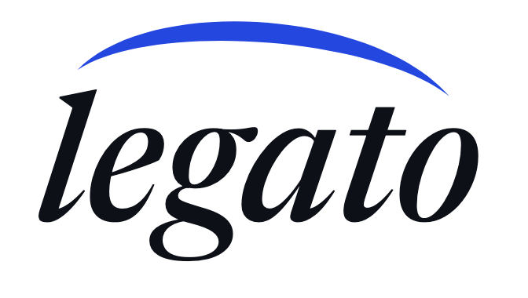
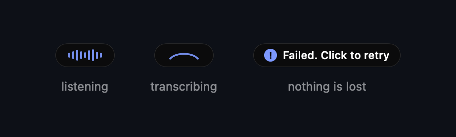

<p align="center">
  <picture>
    <source media="(prefers-color-scheme: dark)" srcset="docs/assets/logo-dark.png">
    
  </picture>
</p>

<p align="center">Hold a key, talk, and the words land where your cursor is.<br>Voice dictation for the Mac that runs on your own machine.</p>

<p align="center"></p>

Legato is a small menu bar app. Hold `fn` in any app, say what you want to write, and let go. A second later the text is typed for you. The speech model runs locally on Apple Silicon, so nothing you say leaves the computer, there is no account, and there is no word limit.

In a score, *legato* tells the player to tie the notes together with no gap between them. That is the idea here: talking should flow into text without you thinking about the tool.

## Install

You need a Mac with Apple Silicon, macOS 14 or newer, and the Xcode Command Line Tools (`xcode-select --install`). Xcode itself is not required.

```bash
git clone https://github.com/Thiago-Pedroso/legato.git
cd legato
make signing   # once, see the note below
make install   # builds Legato.app and copies it to /Applications
open /Applications/Legato.app
```

The first build takes a few minutes because it compiles the speech library.

`make signing` creates a self-signed identity in a keychain of its own. macOS remembers the Microphone and Accessibility permissions by signature, and without a stable one you would have to grant them again after every rebuild. You can skip it if you only build once.

## First run

Legato opens its settings window with a short checklist:

1. **Microphone**, to hear you.
2. **Accessibility**, to notice the dictation key and to type the text into other apps.
3. **Speech model**, a 630 MB download that happens once. The first load also takes a minute or two while macOS prepares the model for your Mac. After that it loads in a fraction of a second.

If you use `fn` as the dictation key, macOS may also react to it by opening the emoji picker or switching keyboards. Legato tells you when that is the case. The fix is in System Settings, Keyboard: set "Press 🌐 key to" to "Do Nothing".

## Using it

| You do | Legato does |
|---|---|
| Hold `fn`, talk, release | Records while the key is down, then types the text |
| Tap `fn` twice | Keeps recording hands-free until you tap once more |
| Press `Esc` while recording | Throws the recording away |
| Click the pill after a failure | Tries the same audio again |

A small black pill appears above the Dock while Legato is busy. Bars that move with your voice mean it is listening. An arc that keeps drawing itself means it is transcribing, and if that takes more than a few seconds it shows a counter so you know it has not frozen. When it has nothing to say it stays out of the way.

Your audio is saved to disk before transcription starts. If anything goes wrong, the recording is still in the History tab and you can run it again, so a long dictation is never lost to a hiccup.

## Settings

**Dictation key.** `fn`, or the right Option, Command or Control key if your keyboard has no `fn`.

**Where transcription runs.** On this Mac, with Parakeet Ultra (the default) or the smaller Parakeet v3. Or through any service that speaks the OpenAI transcription API, such as Groq, OpenAI or a server of your own. With an API your audio is sent to that service; the key is stored in your keychain.

**Vocabulary.** Names and terms you want spelled your way, like `Claude Code` or the name of your company. When the transcript comes close to one of them, Legato corrects it. There are also literal replacements: say "my email", get your address.

**Suggestions from your projects.** Typing a vocabulary by hand is a chore nobody does. If you use Claude Code, run `make claude-command` once and then `/legato-vocabulary ~/Projects/my-project` in any session. It reads the prose in those folders (READMEs, notes, commit messages), picks out the names and jargon, and then tests each one: your Mac speaks the term with a synthetic voice and the speech model transcribes it. Terms the model already gets right are dropped. The rest wait in the Vocabulary tab, each showing how it was misheard, until you accept or dismiss them. Nothing is added on its own. The same steps work from a terminal with `Legato vocab candidates`, `probe` and `suggest`.

**Cleanup.** An optional pass through a chat model that removes filler words and fixes punctuation. It is off by default because it sends the text to the service you pick and adds a short wait.

**History.** Every dictation with its audio. Copy it, listen to it, transcribe it again or delete it. Recordings live in `~/Library/Application Support/Legato`.

## How fast is it

On an M5 MacBook, eight seconds of speech are transcribed in about 0.06 seconds once the model is in memory. Loading it from disk takes around 0.3 seconds.

Keeping that true is most of the engineering. Legato loads the model in the background right after it opens. After 15 minutes without dictating (you can change this) the model leaves memory. When you next press the key the microphone opens at once and the model loads while you are still talking, so the wait overlaps your speech instead of following it.

Parakeet handles 25 European languages. It was tested here mostly with Brazilian Portuguese full of English technical terms ("abre um pull request no GitHub"), which it gets right.

## Compare models on your own voice

The app binary can transcribe a file from the terminal. Record yourself, then:

```bash
/Applications/Legato.app/Contents/MacOS/Legato --transcribe me.wav
/Applications/Legato.app/Contents/MacOS/Legato --transcribe me.wav --model v3
```

## Privacy

With the local model, audio and text stay on your Mac. Legato has no analytics and makes no network requests besides downloading the model once from Hugging Face. If you turn on an API or the cleanup pass, the audio or text goes to the address you typed, and nowhere else. The vocabulary scan is run by Claude Code, so the terms it reads from your folders go through your Claude account; skip it if those folders are confidential.

## What is not there yet

Legato is young. Very short utterances are its weak spot: a lone word like "teste" gives the model too little to tell which language it is hearing, and it sometimes answers in the wrong one. Full sentences do not have this problem. The vocabulary works by correcting the transcript after the fact; it does not yet bias the model itself. The scan tests terms with synthetic voices, which do not pronounce things the way you do. There is no notarized download, so for now you build it from source. Rules per app, editing selected text by voice, and learning new words from your corrections are on the list.

## Development

```bash
make test   # unit tests for the key handling, text processing and history
make run    # build and open build/Legato.app
```

The code is a Swift package with two targets. `LegatoCore` holds the logic that can be tested without a Mac's microphone or screen. `Legato` is the app.

## Credits

Speech recognition is [Parakeet](https://huggingface.co/nvidia/parakeet-tdt-0.6b-v3) by NVIDIA, in the [Parakeet Ultra](https://huggingface.co/moondream/parakeet-ultra) version by Moondream, both under CC BY 4.0. It runs through [FluidAudio](https://github.com/FluidInference/FluidAudio), which is Apache 2.0. Legato owes its shape to the apps that made this kind of dictation feel normal: Wispr Flow, Superwhisper, Handy and VoiceInk.

## License

MIT. See [LICENSE](LICENSE).
